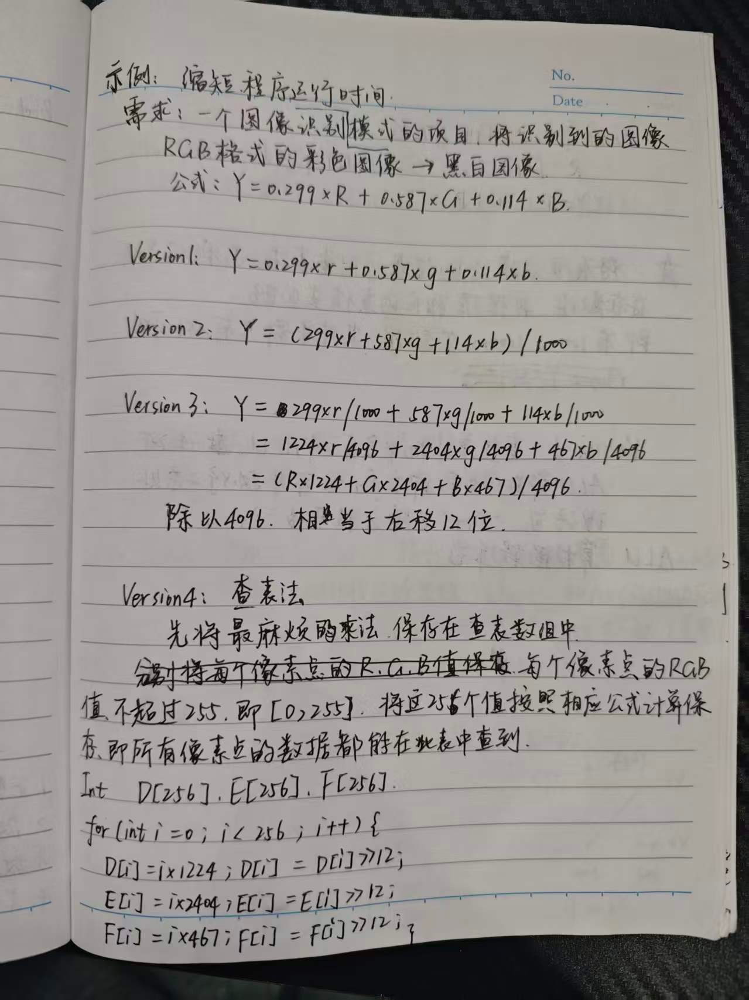
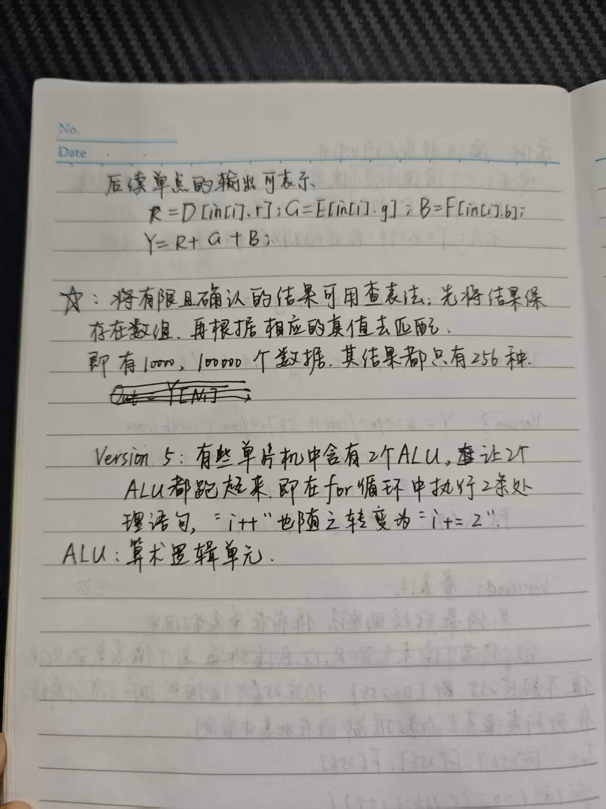

# 《感悟设计》读书笔记

这是一本讲电路设计的书，但让我记住的几乎都不是电路。

作者在序里说，他不想再写一本讲单片机、C 语言或者画板子的书，而是想写设计过程中的思维方式和解决问题的方法。前五章读完，我觉得他写下来的其实是同一件事：**别把系统当成理想模型。**

## 好电路长什么样

作者列了八条，我按自己的理解重新排了序——从"能不能用"到"用得好不好"：

1. 实用，经得起挑剔
2. 稳定，扛得住恶劣条件（但稳定是有代价的）
3. 抗噪，对噪声有免疫力
4. 适应性强，异常输入也能给出稳定输出
5. 灵敏，微弱信号也能分辨
6. 省——功耗、成本、设计周期、使用成本、维护成本
7. 可衍生，模块化程度高，能长出别的设计
8. 朴实，不一定用最贵的 IC

第 6 条和第 8 条放在一起很有意思：**"好"不等于"贵"**。最优雅的实现往往是把问题绕开，而不是堆更多代码。

八条还是抽象。前五章里，作者用具体的例子把"好"拆开了。

## 没有纯数字电路

74HC08 是地地道道的数字芯片，可规格书里，供电 6V 时，低电平上限 2.8V，高电平典型阈值 3.2V，最坏要到 4.2V。输入落在 2.8V 到 3.2V 之间，芯片自己都判不清是 0 还是 1。

作者说，数字电路只是模拟电路的一个子集，就像正方形是矩形的特殊形式。**0 和 1 是约定，电压才是事实。** RS485 的差分线、以太网的变压器、USB 和 SATA 的收发器，处理的其实都是模拟量；CPU 频率高了，地址线和数据线也得按模拟的办法处理。

我给自己列了个检查表：高频、大功率、电源有纹波、线长、电压低、信号弱，占一条，就别把它当纯数字电路看。以前调不通的 SPI、ADC，最后常常是电源、地线或者阻抗的问题。

作者还拿自行车链条打比方：调紧了费力，调松了容易掉链，最好的点要边调边看。模拟电路的工作点，也是这么调出来的。

## 上工治未病

第二章是我读得最慢的一章。扁鹊见蔡桓公，病在腠理时喝点汤药就好，病在骨髓时神仙也没办法。设计也一样，**解决问题是有成本的，越晚越贵。**

作者把开发成本拆成六块：可行性分析、器件资料、元器件、人力、样机测试、时间。最容易被忽略的是时间成本。为了省两毛钱物料，多花两周调试，这笔账多数是亏的。

书里的绣花机案例很典型：220V 电源和 CPU 放同一块板，纹波 150mVpp，SPI 用 1.5 米电缆，IO 没有 ESD；软件 4000 多行一个文件，160 多个全局变量。作者说，其中几条是"项目策划阶段的错误"，是路线错误，改起来极难，最后只能"望桓侯而还走"。

还有一个离职同事留下的 3500 行电表程序：一个文件，函数动辄 150 到 300 行，110 多个全局变量。作者花了 20 个工作日拆模块，又花 15 个工作日重写通信协议，返工 35 个工作日。**代码写得乱，不只是审美问题，是成本问题。**

纹波的故事也一样：150mVpp 降到 75mVpp，实验室跑 20 小时没事；量产以后 3% 到 4% 的板子不稳定，纹波又回到 90 到 100mVpp。作者叫它"斩草未除根"，又用管涌打比方：一开始一锹土就能堵，等堤坝淘空，几卡车沙袋也未必救得回来。

所以文档、注释、命名、评审，这些"不产出功能"的事，都是在问题还小的时候把它按住。作者说，项目规模越大，文档投入的效益越明显。这话在人员流动时才显出分量：技术文档越细，接手的人付出的时间代价越小；反过来，一个没有文档的项目，等于给未来埋了一笔负债。

工程师的通病是"这个我也能写"，然后花三个月写出一个更差的版本。能复用别人的东西，就别重复造轮子——"想造汽车，就不要去设计车轮"。

## 让你的软件飞起来

治未病是防守，这一章讲进攻。

作者要给图像识别项目做 RGB 转黑白，公式 `Y = 0.299R + 0.587G + 0.114B`，图像 640×480×24bit。他把同一件事写了六个版本：double 120 秒，整数运算 45 秒，定点加右移 12 位 30 秒，查表 2 秒，双 ALU 并行 1 秒，unsigned short 加 inline 0.5 秒。

240 倍。作者说："要想突破音障，只能拆掉活塞发动机，安装涡轮引擎。"这句话我抄在本子上。我们平时优化代码，常常是在"把活塞擦得更亮"，真正的大头是换方法。

查表的核心就几句：

```c
static unsigned short D[256], E[256], F[256];

void table_init(void)
{
    for (int i = 0; i < 256; i++) {
        D[i] = (unsigned short)((i * 1224) >> 12);
        E[i] = (unsigned short)((i * 2404) >> 12);
        F[i] = (unsigned short)((i * 467) >> 12);
    }
}

unsigned char rgb_to_gray(unsigned char r, unsigned char g, unsigned char b)
{
    return (unsigned char)(D[r] + E[g] + F[b]);
}
```

R、G、B 只有 0 到 255，先把 256 种结果算好，运行时只查表、加法，不做乘法。4096 是 2 的 12 次方，右移一条指令就完事；系数误差在 8bit 图像上看不出来。

下面两页是我照着书里的例子自己推的笔记，字有点丑，将就看。





**先测量，再优化；先换算法，再抠代码。** 方向错了，把同样的循环写得更漂亮，也只是把 120 秒变成 110 秒。

## 设计的中庸之道

快是好事，但很多设计不是越快越好，而是要在两端之间找一个点。

中庸不是"不冒尖、不落伍"，不是随大流，也不是不讲原则的折中。作者给了四层意思：不走极端、执两用中、合情合理、和而不同。

我最喜欢的是电话机消侧音的例子。电话线只有两根，收和发都在上面，消侧音没调好，自己说话会从听筒里放出来，严重时会啸叫。

这个电路要在设计阶段把 R3 调到最佳点，因为量产时不可能每台都拿电位器慢慢调。为了给元器件离散性和温湿度变化留余量，工厂内控标准比国家标准更严。作者说："常在河边走，一定会湿鞋。远离河边，你就会很安全了。"

**中庸不是差不多就行，是知道两端在哪，选一个能长期工作的点，再给这个点留余量。** 设计时把参数调到"刚好能工作"，量产时就会有一批"刚好不能工作"。

书里还有一个"和而不同"的例子：ucLinux 有 64MB 内存，应用至少剩 32MB，但频繁申请大块内存会崩。查下来是操作系统的问题。改系统？源码上百万行，找到地方就要 10 到 20 天。最后他们在启动时一次性申请大块内存，之后当固定内存用，不释放，问题就绕过去了。

不要求系统完美，也不跟它硬碰，改自己的用法，和它的毛病共处。做固件也一样：别把 CPU 跑到 100%，别把 RAM 用到最后一个字节，别把时序卡在手册的极限值上。留余量不是保守，是给量产、温度和批次差异留活路。

## 搞定故障

故障还是会来。作者说，查故障和医生看病、警察破案没有本质区别，第一步都是收集信息：望、闻、问、切，再加一个"诱"。

"诱"是制造条件，让故障自己出来。电话机"呼入后响一声就没了"，总在阴雨天出问题。作者把电路板和沾水的卫生纸一起放进塑料袋，中间不直接接触，扎紧，24 小时后故障复现。

原因是廉价纸基板受潮，A、B 两点绝缘电阻下降，振铃电压一高就误触发。为了确认，他在干燥的板子上并了一个 5.1MΩ 电阻，故障一模一样。

低概率故障最怕等。等它自己出现，可能等三个月；创造条件，可能 24 小时就复现。

书里的排故工具箱，我挑几个记得住的：

- **替换法**：怀疑谁就换谁，先换故障率高的、好换的。
- **逐层分割法**：从输出往回拆，拆到哪一层噪声消失，故障就在哪一层。
- **计算法**：光端机偶尔告警，地线上有 0.3V 直流，叠加噪声后峰值 0.5V；加上数据链路芯片 0.35V 的 VOL，合计 0.85V，而 CPU 的 VIL 上限是 0.9V，已经贴着临界点。
- **数据统计法**：30 台啸叫的电话机，最后查到 102 电容实际是 2000 到 3000pF。

方法之外，还有两件事更重要。一是**黑箱**：面对不开放源码的库，先看输入输出和权重，别急着拆。TI 的 MODEM 掉线，作者先把软件当黑箱，查电源、调消侧音，问题就解决了。

二是**找不着北的时候**：先用最小系统法把不必要的模块砍掉，再逐步添加，一次只加一个。很多故障的根源在 A，现象却出在 B。

作者在章末说，查找故障的过程，归根结底都是收集信息的过程；很多故障的处理方法很简单，难的是知道问题在哪里。

排故最贵的不是换元件，是判断。先保现场、记录版本和环境、确认复现概率，再动手；一次只改一个变量。我在[《低功耗设计的四条主线》](low-power-design.md)里也写过：先保现场，再动手。

## 最后

五章读完，如果只记一句话：**设计不是把功能做出来，是把系统维持在一个能长期工作的状态里。**

- 模拟电路提醒我，别信理想的 0 和 1；
- 上工治未病提醒我，问题的成本是随时间涨的；
- 软件优化提醒我，方法比努力重要；
- 中庸提醒我，选工作点，还要留余量；
- 搞定故障提醒我，先收集信息，再动手。

这本书讲的是电路，方法却可以平移到固件。下次重读，想补一节自己的反例——那些当时觉得"先这样，以后再说"，后来果然出问题的地方。

## 参考

> 📖 《感悟设计：电子设计的经验与哲理》· 王玮 编著 · 北京航空航天大学出版社，2009
> [豆瓣条目](https://search.douban.com/book/subject_search?search_text=%E6%84%9F%E6%82%9F%E8%AE%BE%E8%AE%A1)

仓库不含该书电子版，想读全文请购买正版。

本文只引用书中几句话，其余是我的理解。手写笔记照片为本人笔记。
