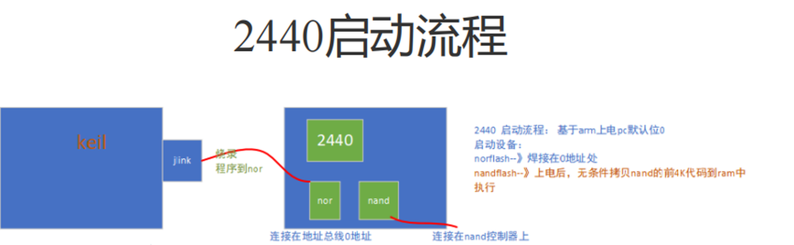

# 《Yocto 项目实战教程》读书笔记（一）：bootloader 干的活，都在内存醒来之前

最近在读《Yocto 项目实战教程：高效定制嵌入式 Linux 系统》，读到 bootloader 这部分时，我想起大学时学 S3C2440 的过程——那是我第一次把"从按下电源到内核跑起来"完整地捋一遍。

趁这次，我把当年的记录翻出来重新看了一遍，做个回顾，和书里的说法摆在一起，整理成这篇笔记。在一套嵌入式 Linux 里，bootloader 是第一个跟板子绑死的东西：内核还能靠设备树装糊涂，它装不了。

回头再看，这些说法其实指向同一件事：

**启动这回事，说到底是在等内存。**

## 书里的五步

2.2.1 节把启动流程分成五步：

1. **CPU 上电/复位**：CPU 进入执行模式，从复位向量开始取指；
2. **执行初始引导代码**：代码在固件（如 BIOS）或 SoC 的 ROM（如 BootROM）里，初始化内存、I/O 这些基础硬件，为加载 Bootloader 做准备；
3. **Bootloader 第一阶段**：进一步初始化硬件，尤其是内存控制器，让 RAM 真正能用；
4. **Bootloader 第二阶段**：把内核和文件系统从闪存、硬盘、SD 卡或网络盘加载到 RAM；
5. **Linux 内核执行**：内核接管控制权，进入正常运行状态。

书里配了图 2-2，是一条链，我照着整理成文字：

```
CPU 上电/复位
 └─▶ ROM 初始引导代码
      └─▶ Bootloader ──(启动参数)──▶ 本地或远程的内核和文件系统 ──▶ 在 RAM 中运行
```

"本地"和"远程"并排，只有两个词，但这两个词解释了嵌入式调试的一半：内核可以从 TFTP 来，根文件系统可以 NFS 挂，改一行代码不用重新烧板子。等到自己写 bootargs 那天，才知道这两个词值多少钱。

2.2.2 节列了常用的 bootloader：嵌入式的 ARM、MIPS 用 U-Boot，x86 用 GRUB，Yocto 两头都管。我自己的理解是，U-Boot 能当嵌入式的默认，不是因为它快，是因为它把板级差异收进了配置文件，正好适合被构建系统批量生产。

## 五步其实是两段

翻出当年的复习笔记，上面是另一套说法：

> Stage1：汇编语言——硬件级别初始化。初始化工作模式 SVC，关闭看门狗、cache、中断，初始化时钟，初始化内存系统。
>
> 关 cache：设备上电之初，内存初始化会相对慢一些，当 CPU 初始化好了、内存还没准备好，此时 cache 向内存中读取数据，就会造成异常，系统就会出问题。
>
> Stage2：C 语言——板级别初始化。初始化需要用到的硬件设备，通过 setenv 设置内核启动参数 bootargs，引导内核时将 bootargs 传递给内核，最后 bootm 启动内核。

（上面这些是我自己当年的笔记，不是书里的原文。）

和书里的五步对一下：

| 书里 | 当年笔记 | 谁在干活 |
| :--- | :--- | :--- |
| CPU 上电/复位 | —— | CPU 取第一条指令 |
| ROM 初始引导代码 | 2440 没有这一步 | 固件，或硬件逻辑 |
| Bootloader 第一阶段 | Stage1：汇编 | CPU，配时钟、配 SDRAM |
| Bootloader 第二阶段 | Stage2：C | CPU，读介质、加载内核 |
| Linux 内核执行 | bootm 之后 | 内核 |

Stage1 那份清单看着长，主角只有一个——内存控制器。关看门狗是怕它在你还没喂狗的时候把板子复位；关中断是怕半路来一个中断，跳到一个还没准备好的向量；关 cache 和 MMU，是怕有人提前去碰还不存在的内存；设 SVC 模式，是为了拿到全部权限。其余的，都是给"配内存"腾地方。

2440 上没有"ROM 初始引导代码"这一步，原因后面再说。

## 关 cache：影子比本体先到

复习笔记里对"关 cache"有解释，大意是 CPU 好了、内存没好，cache 去内存取数会出异常。

这个说法对，但不够狠。cache 是内存的影子，影子比本体先出现，它就会说谎：CPU 以为读到了内存，其实读到的是残值，或者干脆吃一次总线异常。更麻烦的是这种错不稳定——同一份代码，换个上电时序、换个温度，现象就变。这种 bug 查起来，比死机难受得多。

所以 Stage1 的代码必须放在"不用初始化就能读"的地方。2440 上只有两处：NOR flash，或者那颗 4KB 的片内 SRAM。

这就说到当年记下的那张图了。

## 那张图在讲什么



图的上半张是三层结构，我按现在的理解用文字重列一遍：

```
板    S3C2440（ARM920T）+ SDRAM 64M + NOR 2M + NAND 256M
芯片  ARM920T 核 + 4KB 片内 SRAM（0x40000000）+ NOR/NAND/SDRAM 控制器
核    ALU + 寄存器组
```

（图顶那行"4G EMMC"大概是别的页面上的内容，2440 那会儿还不兴 eMMC。）

下半张是启动流程，右边三行字，基本把两种启动方式说清了：

```
基于 arm，上电 PC 默认为 0
norflash → 焊接在 0 地址处
nandflash → 上电后，无条件拷贝 nand 的前 4K 代码到 ram 中执行
```

**NOR 启动**：NOR 接在片选 0 上，也就是地址 0。CPU 复位后 PC=0，取到的第一条指令就是 NOR 里的第一条指令。这叫就地执行（XIP），NOR 有独立的地址线和数据线，可以像 RAM 一样按字节读。

**NAND 启动**：NAND 不是并行总线，它挂在 NAND 控制器上，CPU 在地址空间里看不见它，没法就地执行。2440 的办法是：上电后由硬件把 NAND 的前 4KB 拷进片内 SRAM，再把这块 SRAM 映射到 0 地址，PC 从 0 开始跑。那 4KB 里的代码主要做三件事：配时钟、配 SDRAM、把 U-Boot 剩下的部分从 NAND 搬进 SDRAM，然后跳过去。

| | NOR 启动 | NAND 启动 |
| :--- | :--- | :--- |
| 0 地址上是什么 | NOR 本体 | 4KB 片内 SRAM |
| 能不能就地执行 | 能 | 不能 |
| 第一条指令来自 | bootloader 的第一条 | 硬件拷过来的那 4KB |
| 谁完成搬运 | 不用搬 | NAND 控制器 |
| 卡脖子的地方 | NOR 的容量和价格 | 第一段代码不能超过 4KB |

**4KB 是个硬指标。** 2440 上 u-boot 的链接脚本里，start.o 总是放在最前面，就是为了让"配时钟、配 SDRAM、搬剩下的代码"这几句落在前 4KB 里。超了不会编译报错，板子会一声不响——串口一个字都不吐。

图里那条红箭头"Keil → J-Link → 烧录程序到 nor"，是开发阶段的动作：把 bootloader 直接写进 NOR，绕开 NAND。量产不这么干。

## 图里没画的部分

现在回头看，那张图有个洞：它说"无条件拷贝 nand 的前 4K"，但没说是谁在拷。

当年我以为是一段程序。不是。2440 里没有一块带固件的 BootROM（三星到 6410 才有 iROM），负责拷贝的是 NAND 控制器里的硬件状态机：上电、片选、读前 4KB、写进 SRAM，全是电路做的，一行代码都没有。

从哪启动也不是软件说了算，是 OM[1:0] 两个引脚：00 从 NAND 起，01 和 10 从 NOR 起（16 位或 32 位 ROM），11 进测试模式。上电那一刻，这两个脚的电平就把后面的故事写好了。

这也对得上那五步的起点"ROM 初始引导代码"——那是今天 SoC 的做法。i.MX、STM32MP1 这些片子里有一块 mask ROM，固着一段谁也改不了的代码，它读启动引脚、决定从 SD 卡还是 eMMC 启动、把 SPL 拉进 SRAM。2440 没有这一层，硬件把最脏的活干了，代价是只能干 4KB。

所以书里的"第一阶段/第二阶段"，和今天说的 SPL/U-Boot，是同一件事在不同年代的切法：

```
2440：  硬件拷 4KB ──▶ 片内 SRAM 里的一小段 ──▶ U-Boot 主体（SDRAM）──▶ 内核
今天：  BootROM ──▶ SPL（初始化 DDR）──▶ U-Boot 主体 ──▶ 内核
```

SPL 有的地方叫 MLO，有的地方叫 x-loader，Xilinx 叫 FSBL。名字不同，位置一样：都在"内存还没好"的那一段里。

## 交接：r1、r2 和三个偏移

另一页复习笔记记的是交接：

> uboot 向内核传递的参数：
>
> 参数内容：板子 id、内存大小、内存页大小、cmdline（bootargs）
>
> 传参方式：r1 = 板子 id，r2 = 参数地址
>
> 参数类型：tag_list 链表
>
> 0x100 → 参数
>
> 0x4000 → 映射页表
>
> 0x8000 → 内核地址

32 位 ARM Linux 的启动协议就这么几条：r0 = 0，r1 = machine id，r2 = tag 链表（或设备树）的物理地址，MMU 关着，D-cache 关着，然后跳进内核。

machine id 为什么重要：一份内核 image 要认很多块板子，靠这个号去匹配 machine_desc。号不对，内核第一句就报 `Error: unrecognized/unsupported machine ID`。

三个偏移，当年只记了数字，没记为什么。它们都是相对 SDRAM 起始地址 0x30000000 的偏移：

- 0x30000100 放 tag 链表，靠前，内核一进来就能读到；
- 0x30004000 放一级页表，到 0x30008000 正好 16KB，一张 ARM 一级页表刚好 4096 项 × 4 字节；
- 0x30008000 放 zImage，前面 32KB 让给参数和页表。

这三个数不是 ARM 规定的，是这块板子上 u-boot 和内核之间的约定。换一块板子、换一份 u-boot，数字就变；但"参数、页表、内核各占一段，别打架"这个思路不变。

后来设备树普及，r2 从 tag 链表换成了 DTB 的地址，r1 也不再传 machine id。但"用寄存器递一张纸条"这件事没变。

## 内核要有个家

复习笔记里还有一句："Linux 内核在完成系统的初始化之后需要挂载某个文件作为根文件系统。"

一句话，但这是启动链里最容易断的一环。内核起来的最后一步是挂根文件系统，root= 指哪就去哪挂，挂不上就 panic：

```
VFS: Cannot open root device "..." or unknown-block(0,0)
```

这句我见过不止一次，每次都是 bootargs 写错，或者分区号对不上。

```
console=ttySAC0,115200 root=/dev/mtdblock3 rootfstype=yaffs2 rw init=/linuxrc
```

NAND 上是 mtdblock，SD 卡上是 mmcblk0p2，网络上是 nfs。同一块板子，三种调试方式，改的都是这一行。

Yocto 在这里的位置：它把 bootloader、内核、设备树、根文件系统都做成可复现的产物，谁烧到哪个分区也写在配置里。但开机顺序没变——bootloader 仍然是那个谁也不信、只信自己的角色。

## 下次怎么避免

- 拿到一块新板子，先找两样东西：内存映射表、启动方式怎么选（引脚或熔丝）。找不到就先别编译。
- 复位后 PC 是多少、那个地址上是什么、那段代码有多大的地方可放——这三个问题答得上来，启动流程就懂了一半。
- 移植 bootloader，先确认 TEXT_BASE 和 SDRAM 大小，再谈编译。64MB 的板子一般把它贴着 SDRAM 顶端放（0x33F80000），链接地址错了，代码跑起来也是"看起来在跑"。
- 起不来先看串口有没有第一行字。一个字都没有，问题在 Stage1（时钟、SDRAM、串口）；有 U-Boot 提示符但内核不动，问题在加载地址、bootargs、机器码。
- 4KB、16KB 这种数字，记来由，别记结论。

## 最后

读到这里，我一直在想当年那几页记录：整理它的时候，我以为自己在记"流程"；现在看，记下的是"约束"——4KB 的 SRAM、0 地址上的 NOR、NAND 控制器那条看不见的线。

启动代码难写，不是因为汇编难，是因为它工作在一切约定都还没成立的时候。

## 参考

> 📖 《Yocto 项目实战教程：高效定制嵌入式 Linux 系统》· 孙杰 著 · 电子工业出版社，2025 · ISBN 978-7-121-50075-6
> [豆瓣条目](https://search.douban.com/book/subject_search?search_text=Yocto%E9%A1%B9%E7%9B%AE%E5%AE%9E%E6%88%98%E6%95%99%E7%A8%8B)

文中 2440 的图和两段笔记，都是当年学习时记下的，凭回忆整理，数字若有记错，以 S3C2440 数据手册为准。仓库不含该书电子版，这里只记 2.2 节，后面的章节慢慢补。
